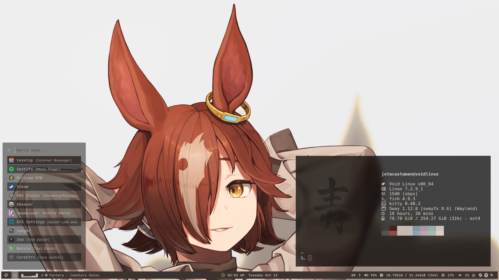

# 🌸 Dotfiles

> My personal configuration files for my Void Linux setup.



---

## 💻 System

| Category | Software |
|----------|----------|
| OS | [Void Linux](https://voidlinux.org) (Wayland) |
| Window Manager | [Sway](https://github.com/swaywm/sway) |
| Greeter | [SDDM](https://github.com/sddm/sddm) |

## 🖥️ Terminal & Editor

| Category | Software |
|----------|----------|
| Terminal | [Kitty](https://sw.kovidgoyal.net/kitty) |
| Shell | Fish |
| Editor | [Neovim](https://neovim.io) / [Zed](https://zed.dev) |
| File Manager | [Ranger](https://ranger.github.io) / Nautilus |

## 🎨 Theming

| Category | Software |
|----------|----------|
| Bar | [Waybar](https://github.com/Alexays/Waybar) |
| Launcher | [Rofi](https://github.com/davatorium/rofi) |
| Icons | [Papirus Dark](https://github.com/PapirusDevelopmentTeam/papirus-icon-theme) |
| Font | [JetBrains Mono Nerd Font](https://www.nerdfonts.com) |

## 🌐 Apps

| Category | Software |
|----------|----------|
| Browser | [Firefox](https://www.firefox.com/en-US/) |
| VPN | [Mullvad](https://mullvad.net) |
| Screen Recorder | [OBS Studio](https://obsproject.com) |
| Notes | [Mousepad](https://github.com/codebrainz/mousepad) |

## 🦀 Waybar Rust Modules

Custom Waybar modules written in Rust, replacing the old shell scripts. A single binary (`waybar-mods`) with one subcommand per module — source in [`.config/waybar/rust-modules`](.config/waybar/rust-modules).

| Command | Module |
|---------|--------|
| `waybar-mods cava` | Audio visualizer (▁▂▃▄▅▆▇█) fed by [cava](https://github.com/karlstav/cava) |
| `waybar-mods mpris [player]` | Now playing (default: `spotify`) with a looping marquee title |
| `waybar-mods language [filter]` | Sway keyboard layout (BR/US), updated by Sway input events — `filter` is part of the keyboard identifier |

All modules run continuously, print only when something changes, and exit together with Waybar, so restarting the bar never leaves orphaned processes behind.

<details>
<summary>📦 Install on a fresh system</summary>

```sh
# Dependencies (Void Linux)
sudo xbps-install -S sway waybar cava playerctl curl base-devel

# Rust toolchain
curl --proto '=https' --tlsv1.2 -sSf https://sh.rustup.rs | sh

# Build and install the binary
cd ~/.config/waybar/rust-modules
cargo build --release
install -Dm755 target/release/waybar-mods ~/.config/waybar/bin/waybar-mods
```

Also needed: Spotify (for the MPRIS module) and the JetBrains Mono Nerd Font (icons).

`target/` and `bin/` are git-ignored, so the build step is required after every fresh clone. The `exec` paths in `config.jsonc` are absolute (`/home/jotacastaman/...`): adjust them if the username changes.

</details>
